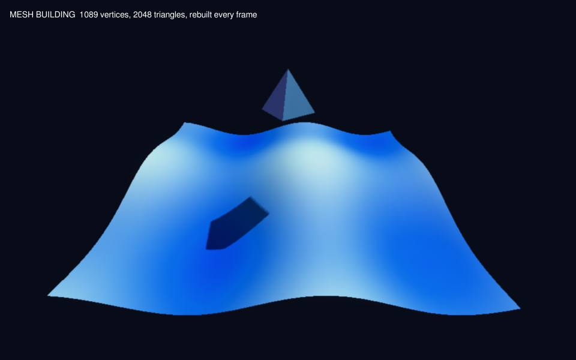

# Building meshes

Scripts can make a mesh from vertices and triangles, and read or change the vertices of any mesh: one from `CreateMesh`, a primitive (`CreateCube`, `CreateSphere`, …), or a loaded model's part.



```basic
m = CreateMesh()
a = AddVertex(m, -1, 0, -1, 0, 1)   ; x, y, z [, u, v]
b = AddVertex(m,  1, 0, -1, 1, 1)
c = AddVertex(m,  0, 0,  1, 0.5, 0)
AddTriangle(m, a, c, b)
VertexColor(m, c, 255, 120, 0)
UpdateMesh(m)
```

A mesh is an ordinary entity: position it, texture it, give it a material or a physics body like any other.

## Commands

| Command | What it does |
| --- | --- |
| `CreateMesh([parent])` | An empty mesh entity |
| `AddVertex(m, x, y, z [, u, v])` | Add a vertex; returns its index, counting from 0 |
| `AddTriangle(m, v0, v1, v2)` | Add a triangle; returns its index. Counter-clockwise seen from the front |
| `VertexCoords(m, i, x, y, z)` | Move a vertex |
| `VertexNormal(m, i, nx, ny, nz)` | Set a normal (otherwise `UpdateMesh` smooths them for you) |
| `VertexColor(m, i, r, g, b)` | 0–255; multiplies the material colour |
| `VertexTexCoords(m, i, u, v [, set])` | Texture coordinates; `set` 1 is the second UV set |
| `VertexX/Y/Z(m, i)`, `VertexNX/NY/NZ`, `VertexU/V(m, i [, set])`, `VertexRed/Green/Blue` | Read a vertex back |
| `CountVertices(m)`, `CountTriangles(m)`, `TriangleVertex(m, t, corner)` | Sizes and triangle corners (0–2) |
| `UpdateMesh(m)` | Send the changes to the GPU now. Changes are also sent by themselves before the next frame |
| `UpdateNormals(m)` | Recompute smooth normals from the triangles (after moving vertices) |
| `ClearMesh(m)` | Remove every vertex and triangle |

## Notes

- **Normals:** a mesh whose normals you never set gets smooth normals on `UpdateMesh`. Vertices are smoothed only where triangles share them, so for hard edges give each face its own vertices (the pyramid in `examples/meshbuild.mb` does).
- **Vertex colours** use the lit shader; they show with Phong materials. PBR materials ignore them.
- **Second UV set:** stored in the mesh (`VertexTexcoord2`) for custom shaders; the built-in materials sample the first set.
- **Physics:** a mesh body is made from the triangles when you add it; change the mesh, then re-add the body.
- **Speed:** each `UpdateMesh` uploads the whole mesh. A thousand vertices every frame is fine (`examples/meshbuild.mb` does).
