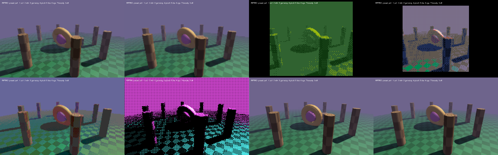

# Retro rendering

moonBASIC can make a scene look like it came from a 1990s console or PC, from one call or one effect at a time. Every effect is optional, off by default, and changes nothing when off. They mix with everything else: PBR, shadows, fog, post-processing.



## Presets

```basic
SetRetroPreset("ps1")
```

| Preset | Look |
| --- | --- |
| `ps1` | 320 px wide, vertex snapping, affine textures, 15-bit colour with dither, nearest textures, fog in 8 bands |
| `n64` | 320 px wide, smooth textures, 15-bit colour with a light dither |
| `gameboy` | 160 × 144 pixel-perfect, four greens, dithered, flat shading, nearest textures |
| `pico8` | 128 × 128 pixel-perfect, the 16 PICO-8 colours, dithered |
| `dos` | 320 × 200, 6 levels per channel (216 colours), nearest textures |
| `cga` | 320 × 200, black / cyan / magenta / white, full dither |
| `lowpoly` | Flat (faceted) shading only, full resolution |
| `off` | Everything off |

A preset sets every effect below; change any of them after it. `examples/retro.mb` shows them all on one scene (keys 1–7, 0).

## Screen effects

These happen in the post pass, so they turn post-processing on. HUD text (`Text`, `HudPrint`) and ImGui draw afterwards at full resolution, so the interface stays readable.

| Command | What it does |
| --- | --- |
| `SetRetroResolution w [, h, pixelPerfect]` | Render the scene at `w` × `h` and scale it up with sharp pixels. `h` 0 follows the window's shape. `pixelPerfect` 1 uses the largest whole-number scale and black bars, so every pixel is the same size. `0` turns it off |
| `SetRenderScale f` | Render at `f` (0.25–1) of the window and scale up smoothly: a speed setting, not a look. `GetRenderScale()` |
| `SetRetroColors levels` | Levels per colour channel: 32 is 15-bit colour, 6 is 216 colours, 2 is 8 colours. 0 turns it off |
| `SetRetroDither amount` | 0–1 ordered (4 × 4 Bayer) dither between levels or palette colours, in the scene's pixels so it stays crisp |
| `SetRetroPalette name$` | Snap every pixel to the nearest colour of `gameboy`, `pico8`, `cga`, `ega`, `c64`, `grey4`, or a PNG (each distinct colour, up to 256). `"none"` turns it off |
| `SetRetroTextures on` | Nearest-neighbour filtering on every scene texture: crisp texels, no smoothing |
| `SetTextureFilter tex, mode$` | `"nearest"` or `"linear"` for one texture |

With `SetRetroResolution`, shadows, bloom, and ambient occlusion also work at the low resolution, so it is faster as well as chunkier.

## Geometry effects

These happen in the lit shaders (Phong, PBR, terrain; snapping and fog bands on water too). Details in [GRAPHICS.md](GRAPHICS.md#retro-geometry).

| Command | What it does |
| --- | --- |
| `SetRetroSnap w, h` / `SetRetroSnap n` | Snap vertices to the pixel grid of a `w` × `h` screen (or `n` columns), the PS1 wobble |
| `SetRetroAffine amount` | 0–1 blend to affine (screen-linear) texture coordinates, the PS1 texture warp |
| `SetRetroFlat on` | Face normals: flat, low-poly shading |
| `SetRetroFogSteps n` | Fog in `n` hard bands |

## Tips

- **Floors:** vertex snapping moves the far corners of very large polygons, and a single 600 m ground quad slides under the camera. Tile floors (as `examples/retro.mb` does) or use terrain, as real PS1 games did.
- **Affine warp** only shows on big triangles close to the camera, so subdivided meshes barely warp.
- **Palettes:** a palette with few colours needs dither to show shading; with no dither, smooth gradients become flat areas.
- **Cost:** the screen effects are one post pass. A low retro resolution is usually faster than full resolution.
